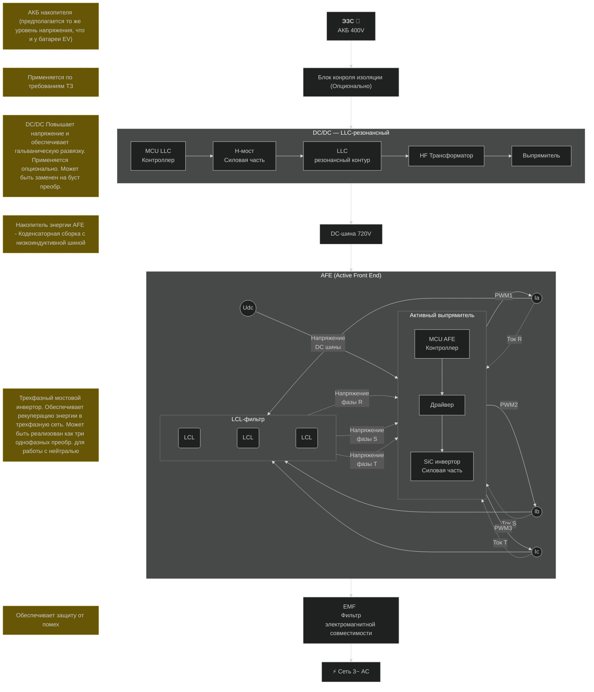
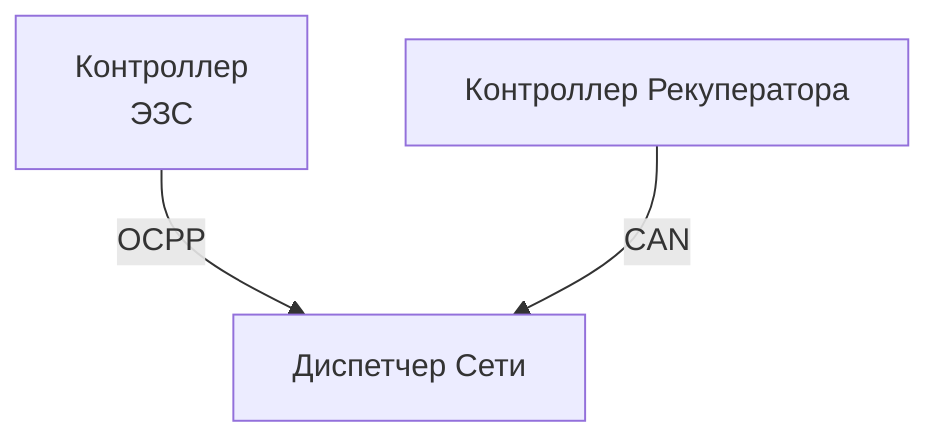

# Структурная схема Charger to Grid преобразователя

## Информационный обмен

Информационный обмен обеспечивается через диспетчера, который определяет необходимость и обьем энергии к рекуперации. Диспетчер представляет собой SCADA систему верхнего уровня подключенной к энерго узлу.

## Пример реализации
В самом простом случае в качестве DC\DC и АFE может быть использован готовый модуль UBR100030 — 30kW Bidirectional AC/DC Power Module (https://www.uugreenpower.com/), в данном случае 4 модуля в параллель обеспечивают 120 кВт мощности. Модули управляются по CAN линии через контроллер рекуператора. 

    